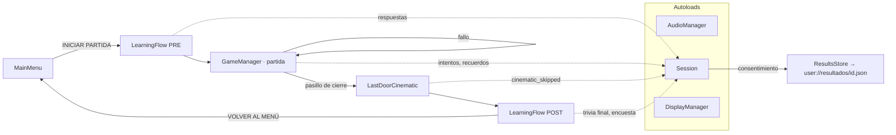
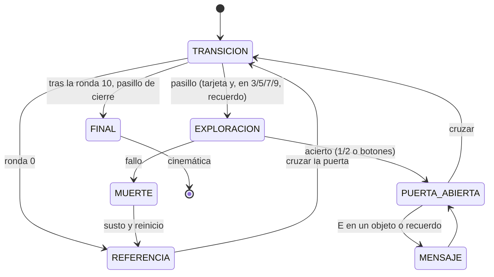
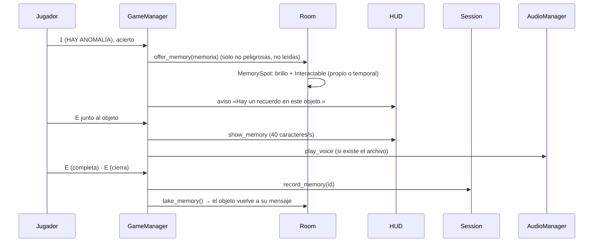

# Arquitectura — La Habitación 13

## Visión general

## Flujo de la partida

## Sistemas y responsabilidades

| Sistema | Clases | Responsabilidad |
|---|---|---|
| Flujo de partida | `GameManager` | Coordina estados, rondas, pasillos, puerta, pausa y fallo. No decide reglas: las delega en las clases siguientes. |
| Reglas | `AnswerEvaluator`, `RunState` | Evaluación pura de una respuesta (6 combinaciones) y marcador de la partida. |
| Selector | `AnomalySelector` | Elige anomalía o sala normal por tramos de dificultad, sin repetir anomalía, objeto ni tema, con niveles de relajación. |
| Datos | `AnomalyData`, `AnomalyModification`, `RoomData`, `CatalogLoader` | Anomalías como recursos `.tres` (36), aplicadas como modificaciones de la habitación base. |
| Mundo | `Room`, `Interactable`, `Player`, `Monster` | La habitación reutilizable, sus objetos examinables (con prioridad para recuerdos), el jugador y los Testigos. |
| Entidades y efectos | `EntityAmbience`, `JumpscarePlayer`, `JumpscareBase` (+10 sustos) | Efectos de entorno (parpadeos, vibración, pistas luminosas de las anomalías sonoras) y un susto propio por anomalía peligrosa. |
| Interfaz de juego | `HUD`, `SceneTransition`, `Corridor` | Muestra estado, mensajes, panel de recuerdo con texto progresivo, pausa; el pasillo con tarjeta y viñeta. |
| Audio | `AudioManager` (autoload), `SoundCatalog` | Reproduce por nombre; buses Music/Ambient/SFX/Danger; voces opcionales con atenuación de música. |
| Ajustes | `UserSettings`, `DisplayManager` (autoload) | `user://settings.cfg` (volumen, pantalla completa); F11 global. |
| Aprendizaje | `Session` (autoload), `TriviaScorer`, `ResultsStore`, `LearningContent`, `TriviaQuestion`, `HowToText`, `LearningFlow` | Sesión anónima, puntuación y ganancia, persistencia JSON, textos editables, «Cómo jugar» desde el InputMap y conductor de pre/post-juego. |
| Vistas | `InfoView`, `PageView`, `TriviaView`, `ResultsView`, `SurveyView`, `HowToView`, `LearningPause`, `LearningUi` | Solo muestran y emiten señales. |
| Recuerdos | `ObjectMemory`, `ObjectMemoryCatalog`, `MemorySpot`, `CorridorMemory`, `MemoryTexts`, `MemoryVignette` (+4 viñetas) | Recuerdos de objeto tras acertar, recuerdos del pasillo y sus textos. |
| Cinemática | `LastDoorCinematic`, `LastDoorStage` | «La última puerta»: fases con tiempo escalable, salto manteniendo E. |
| Herramientas | `dev/` | Generación de audio, galería, hoja de contacto, catálogo exportado, capturas, análisis de resultados. |

## Cómo encaja un recuerdo de objeto

## Por qué así (SOLID y código limpio)

- **Responsabilidad única.** Cada clase hace una cosa. `TriviaScorer` puntúa, `ResultsStore` escribe archivos, `HowToText` redacta los controles, `MemorySpot` gestiona un recuerdo disponible y las vistas solo pintan. `GameManager` coordina, pero las reglas viven fuera (`AnswerEvaluator`, `AnomalySelector`, `RunState`).
- **Abierto/cerrado.** Una anomalía nueva es un `.tres`, no código. Un recuerdo nuevo es una entrada de `object_memories.tres`. Una viñeta nueva es una escena que hereda de `MemoryVignette` e implementa `_paint`. Un sonido nuevo es una línea de `SoundCatalog`. Un efecto de entorno o una pista luminosa es una entrada de `EntityAmbience.EFFECTS`/`CUES`.
- **Sustitución de Liskov.** Las 10 escenas de susto son intercambiables como `JumpscareBase`. Las 4 viñetas y el escenario de la cinemática, como `MemoryVignette`.
- **Segregación de interfaces.** Las vistas exponen señales pequeñas (`chosen`, `finished`, `submitted`, `closed`) y el conductor solo depende de ellas.
- **Inversión de dependencias.** El juego pide sonidos por nombre y nunca por archivo. `Session` usa un `ResultsStore` que las pruebas sustituyen por otro apuntando a una carpeta temporal. `UserSettings.path`, `AudioManager.voice_dir` y `MainMenu.folder_opener` se pueden cambiar en las pruebas.

Las 10 sugerencias de código limpio aplicadas:
1. Nombres descriptivos en español.
2. Funciones pequeñas.
3. KISS: sin capas innecesarias.
4. Sin repetición: `LearningUi`, `MemoryVignette` y `ScreenCatalog` se comparten.
5. Lógica separada de la interfaz: scorer, store, sesión y contenido no tienen nodos.
6. Constantes con nombre.
7. Tipado estático.
8. Tabulaciones.
9. Comentarios solo donde explican el porqué.
10. Textos y datos fuera del código: los recursos de `resources/learning/`.

## Persistencia

- `user://resultados/<id>.json`: un archivo por participante, solo con consentimiento. El formato está en `docs/aprendizaje_y_evaluacion.md`.
- `user://settings.cfg`: volumen general y pantalla completa.

En Windows, `user://` es `%APPDATA%\Godot\app_userdata\Room 13\`.

## Pruebas

`tests/run_tests.gd` ejecuta todas las suites `tests/test_*.gd` en modo headless, y con `--report` escribe `docs/informe_de_pruebas.md`. `tests/game_driver.gd` maneja una partida real con las esperas a cero (`pacing = 0`). Las pruebas de maquetación montan cada pantalla en un `SubViewport` a cada resolución, con `dev/screen_catalog.gd`.
